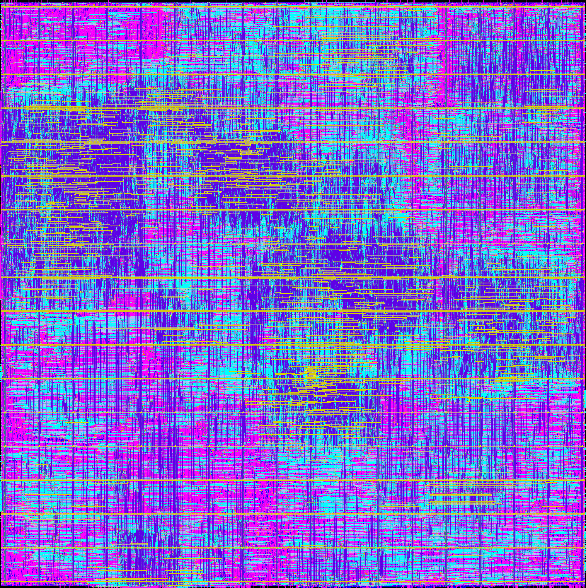
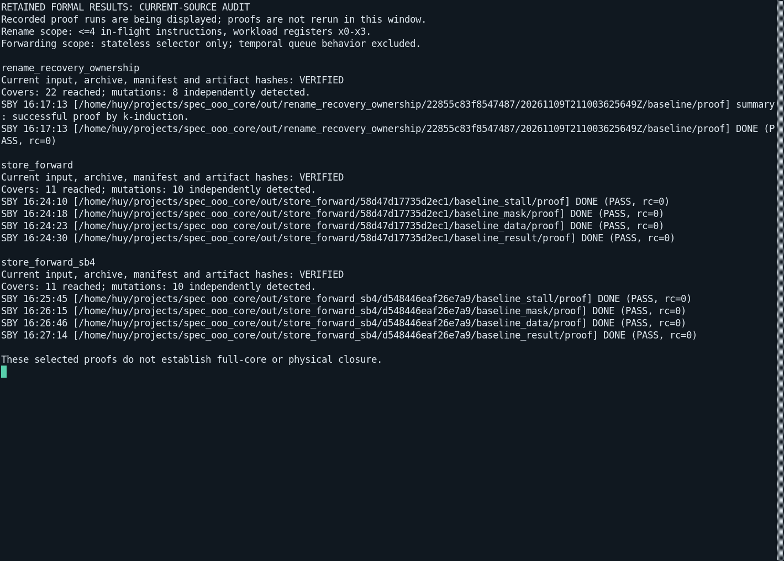
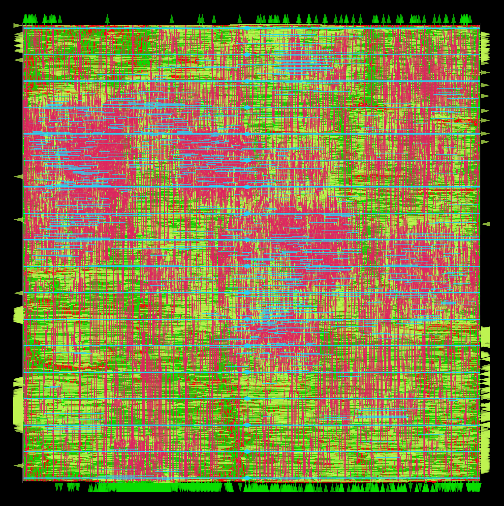
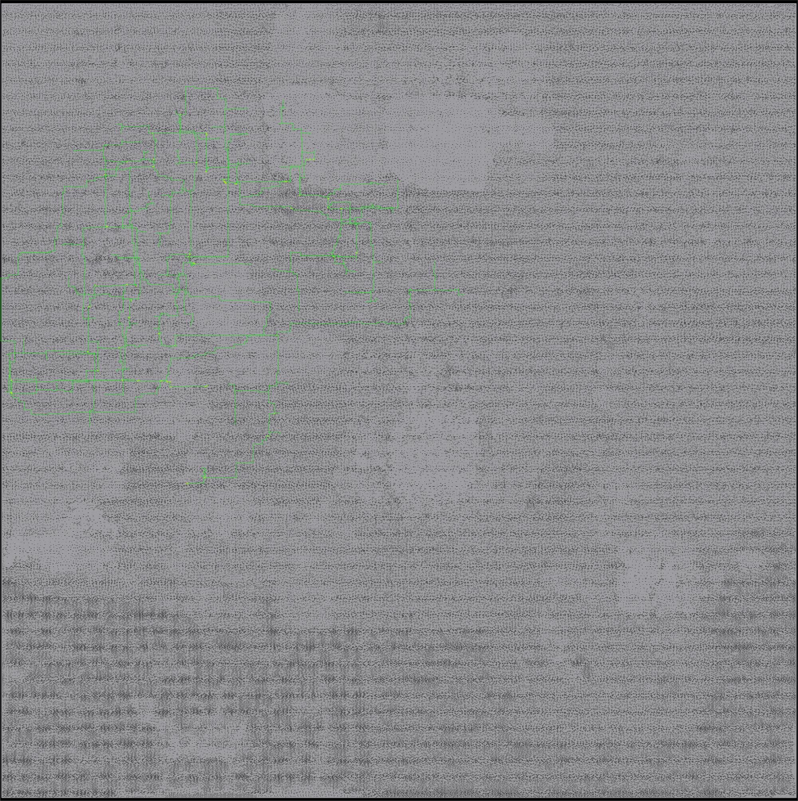
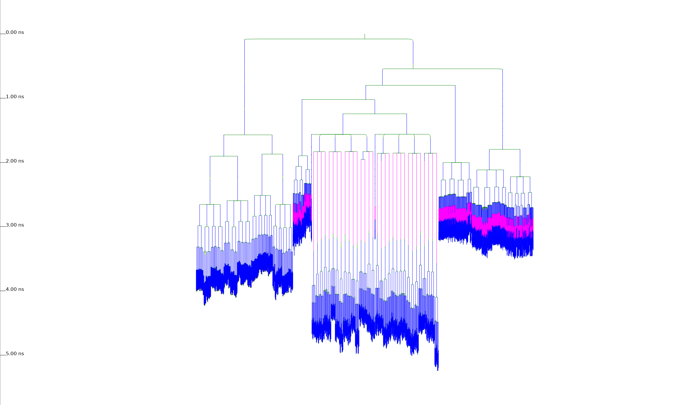

<h1 align="center">H Core</h1>

A two-wide out-of-order RV32IM core in SystemVerilog, taken from RTL to a routed Sky130 GDS.

Hi everyone! This is the RV32IM processor I’ve researched and designed over the
past semester. It's my first step into superscalar design, with multicore development
as a future goal.

Written in SystemVerilog, this two-wide core supports machine-mode Zicsr and
Zifencei. It executes instructions out of order and retires them in program
order. The past month of optimization has been brutal, especially dependencies
and hazards. The design is still evolving tho.

<i>The final GDS in KLayout: 2653 × 2664 µm on Sky130, 414,631 standard cells, fully routed with 0 routing DRC errors.</i>

## Performance

| | |
|---|---|
| ISA | RV32IM, machine-mode Zicsr and Zifencei |
| Pipeline | two-wide fetch, out-of-order issue, in-order retirement |
| CoreMark (RTL simulation, 2 iterations) | 633,494 cycles for 647,465 instructions (0.98 cycles per instruction) |
| Technology | SkyWater Sky130 (`sky130_fd_sc_hd`), LibreLane 3.0.16 |
| Clock target | 15 ns (66.7 MHz) |
| Clock after synthesis | 10.94 ns with ideal wires, 14.82 ns with a 10× wire estimate |
| Clock after placement, before routing | 15.10 ns (0.10 ns short of 15 ns) |
| Clock after routing | 24.07 ns (41.5 MHz), typical corner |
| Size | 7.07 mm² die, 49,442 flip-flops, no SRAM macros |

The logic fits a 15 ns clock: synthesis estimates stay under 15 ns, and the
placed design came within 0.10 ns of it. The drop to 24.07 ns happens in
routing. The flow ran without post-route design repair, so the routed wires
added about 9 ns to the slowest paths. Closing that gap needs more time on
the physical design.

## Architecture

Here’s a quick look at the specs:

- **Frontend:** two-wide fetch with TAGE branch prediction.
- **Scheduling:** a unified 16-entry issue queue and two execution ports.
- **Registers:** 64 physical registers, four read ports, two write ports, and
  accepted-writeback bypass.
- **Recovery:** a 32-entry reorder buffer and eight branch checkpoints restore
  speculative register mappings.
- **Execution:** integer ALUs, branch/jump resolution, hardware multiplication,
  and iterative division.
- **Memory:** split L1 caches, load/store queues, forwarding, and a retired-store
  buffer; stores and device accesses retain ordered head ownership.

How an instruction moves through the core:

| Stage | What happens |
|---|---|
| Fetch | Two instructions per cycle from a line buffer, following TAGE predictions; misses go to the L1 instruction cache. |
| Rename | Physical renaming separates speculative values; checkpoints restore mappings after a misprediction. |
| Issue | The shared issue queue selects ready work; accepted writeback wakes dependents. |
| Execute | Port 0 runs branches, jumps and ALU work. Port 1 shares ALU, RV32M and memory completion. |
| Retire | The ROB retires in order; head ownership gates system and memory side effects. |

See the [architecture guide](docs/architecture/README.md) for design choices.

## Verification

| Method | What it checks |
|---|---|
| RTL simulation | Verilator with C++ reference models, directed and random tests, assertions, stall and reset cases |
| Architectural comparison | Sail and Spike compare retired instructions against the RTL; selected ACT4 tests |
| Formal verification | SymbiYosys bounded memory checks, forwarding proofs, rename induction |
| Mutation testing | deliberate RTL faults must be caught by the tests and proofs |
| Gate-level simulation | a bench (`verif/gls/`) runs CoreMark on the RTL and the routed netlist and compares them cycle by cycle |

| Result | Status |
|---|---|
| Whole-core directed run | 17 directed events match the software model |
| RV32M unit | fresh baseline seeds pass |
| Store forwarding | combinational selector proofs pass |
| Rename ownership | inductive safety proof passes (up to four in-flight instructions) |
| CoreMark, RTL | 633,494 cycles, 647,465 instructions retired, exit 0 |
| CoreMark, routed netlist vs RTL | not completed (bench ready; netlist build stopped) |

Checked whole-core execution:

Fresh RV32M RTL baseline simulation:

Retained formal results, verified against current sources:

See the [verification guide](docs/verification/README.md) for commands and
scope.

## Physical design

The core goes through synthesis, placement, clock-tree synthesis, routing and
GDS stream-out with LibreLane 3.0.16 on Sky130. It is fully routed but misses
its 15 ns target.

| Metric | Value |
|---|---|
| Clock, target | 15 ns (66.7 MHz) |
| Clock, achieved | 24.07 ns typical, 48.44 ns slow corner; 15 ns met only in `min_ff_n40C_1v95` |
| Hold | fails in all 9 corners (typical worst −1.02 ns) |
| Die / utilization | 7.07 mm² / 54.6 % |
| Standard cells / flip-flops / clock gates | 414,631 / 49,442 / 1,088 |
| Routed wire | 21.29 m |
| Power (vectorless) | 0.182 W typical |
| Routing DRC / antenna nets | 0 / 800 |
| IR drop, typical | 1.38 mV (0.08 %) |
| Magic DRC, KLayout DRC, LVS, XOR | not run |

The worst setup path runs from load/store completion through the issue queue
and the register file into operand capture. Its 61 cells take 23.3 ns of cell
delay against 0.65 ns of wire delay, so logic depth sets the clock.

| | |
|---|---|
|  |  |
| Routed design in OpenROAD. | The 61 nets of the worst setup path. |

See the [physical design page](docs/physical/README.md) for timing analysis,
trade-offs, reproduction steps and the evidence index.

## Future work

- **Optimize logic depth.** Add a pipeline register on the worst path
  (load/store completion → issue select → register-file read). It holds 32
  logic gates and misses timing by 9.07 ns in the typical corner. Trade the
  extra cycle against CoreMark CPI.
- **Optimize corner timing.** Close setup in the slow corner (48.44 ns today)
  and hold in all nine corners. Constrain inputs against clock latency, turn on
  post-route repair, and balance the cache clock gates (2.27 ns skew).
- **Clean up the layout.** Repair the 800 antenna nets and the max slew and
  capacitance violations, then re-route and rerun sign-off.
- **Close verification.** Run sign-off DRC and LVS, finish the gate-level
  CoreMark run, refresh full regression, and add a timing-annotated gate-level
  simulation.
- **Multicore.** Build on this core toward a multicore design.
