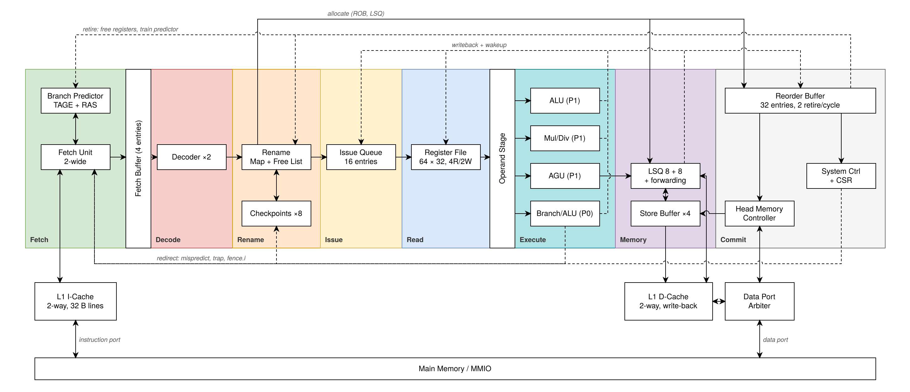
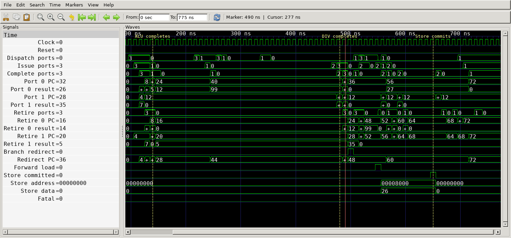
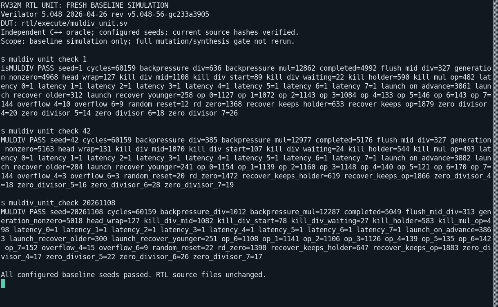

<h1 align="center">H Core</h1>

Hi everyone! This is the RV32IM processor I’ve researched and designed over the
past semester. It's my first step into superscalar design, with multicore development
as a future goal.

Written in SystemVerilog, this two-wide core supports machine-mode Zicsr and
Zifencei. It executes instructions out of order and retires them in program
order. The past month of optimization has been brutal, especially dependencies
and hazards. The design is still evolving tho.

## Architecture

Here’s a quick look at the specs:

- **Frontend:** two-wide fetch with TAGE branch prediction.
- **Scheduling:** a unified 16-entry issue queue and two execution ports.
- **Registers:** 64 physical registers, four read ports, two write ports, and
  accepted-writeback bypass.
- **Recovery:** a 32-entry reorder buffer and eight branch checkpoints restore
  speculative register mappings.
- **Execution:** integer ALUs, branch/jump resolution, hardware multiplication,
  and iterative division.
- **Memory:** split L1 caches, load/store queues, forwarding, and a retired-store
  buffer; stores and device accesses retain ordered head ownership.

See the [architecture guide](docs/architecture/README.md) for the RTL diagram
and design choices.

## Verification

Verification uses independent C++ models, architectural trace comparison,
mutation checks, and targeted formal properties. See the
[verification guide](docs/verification/README.md) for commands and results.

Checked whole-core execution:

Fresh RV32M RTL baseline simulation:

Retained formal results, verified against current sources:

## Current progress

RV32M and both L1 caches are integrated. The directed whole-core waveform passes;
full regression needs refreshing, and physical timing closure remains unverified.
