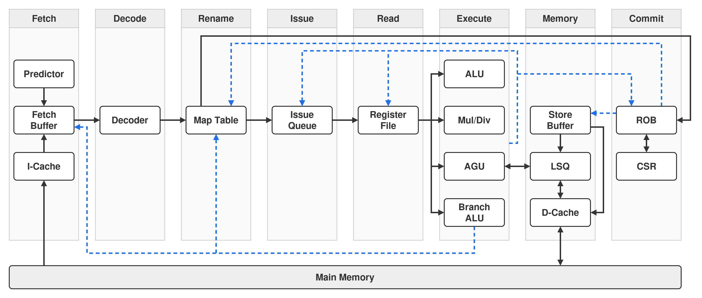

# Architecture

[RTL sources](../../rtl/)

## Design choices

- Fetch delivers two instructions per cycle from a line buffer and follows TAGE
  predictions.
- Physical renaming separates speculative values; checkpoints restore mappings.
- A shared issue queue selects ready work; accepted writeback wakes dependents.
- Port 0 runs branches, jumps, and ALU work; port 1 shares ALU, RV32M, and
  memory completion resources.
- The ROB retires in order; head ownership gates system and memory side effects.
- Separate L1 caches serve instruction and data traffic.

Current [`chip_top`](../../rtl/core/chip_top.sv) builds RV32M, TAGE prediction,
early loads, and both L1 caches, with separate instruction and data memory ports.

[Pipeline reference](https://docs.boom-core.org/en/latest/sections/intro-overview/boom-pipeline.html)
· [Verification](../verification/README.md)
