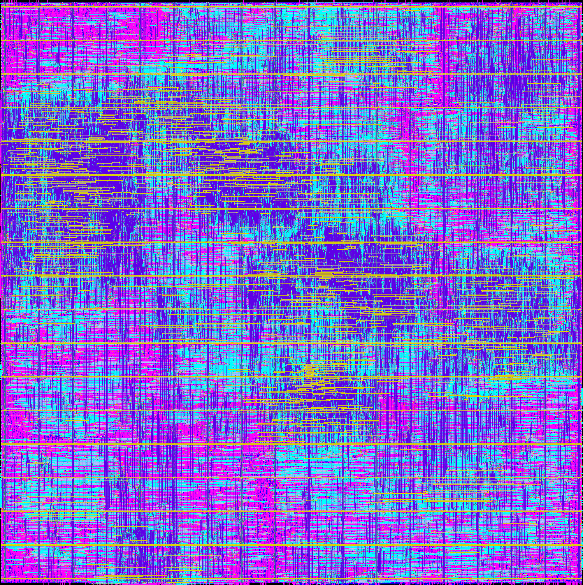
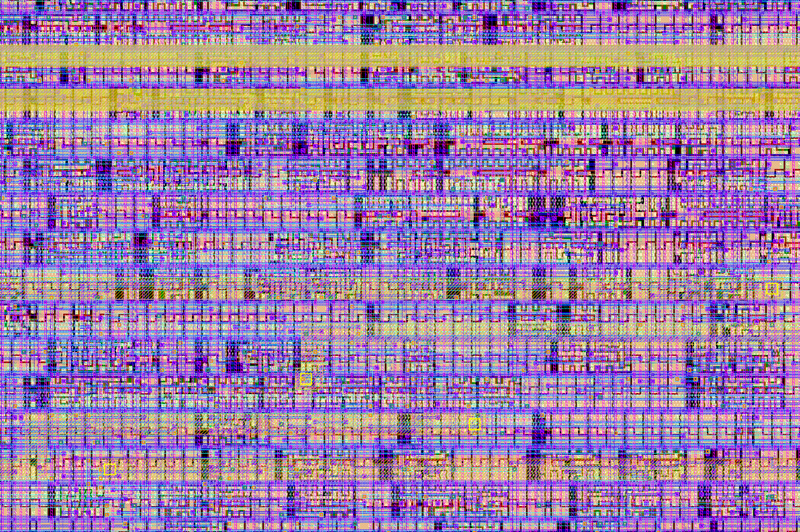
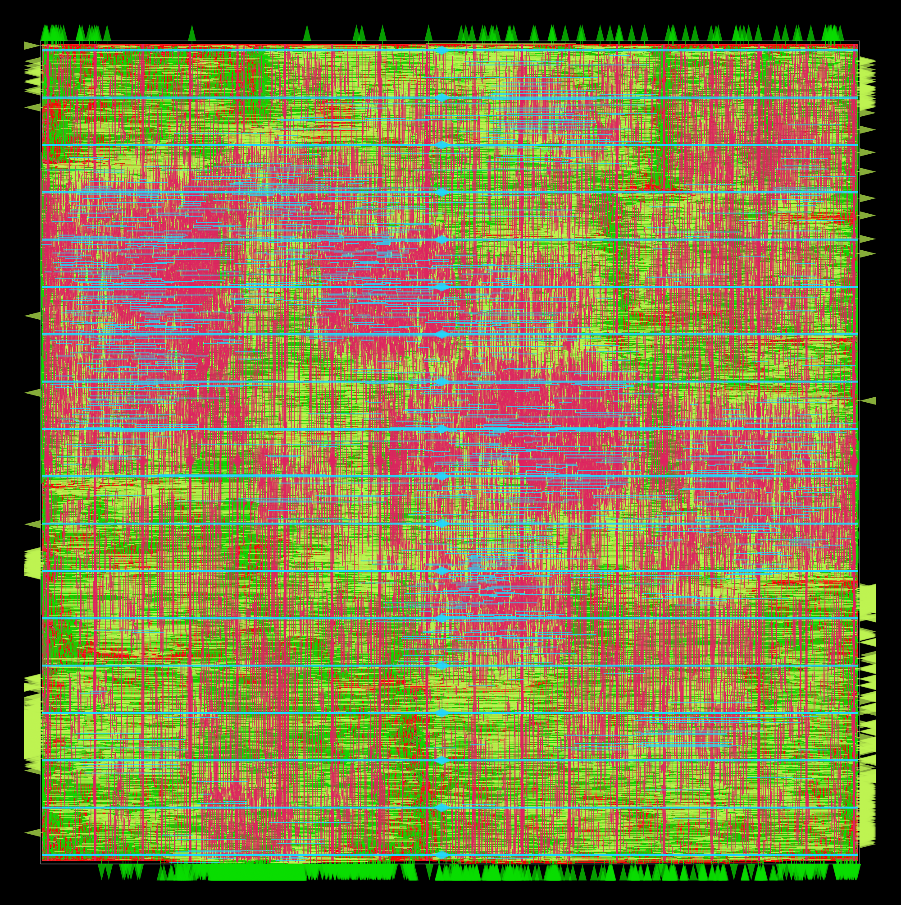
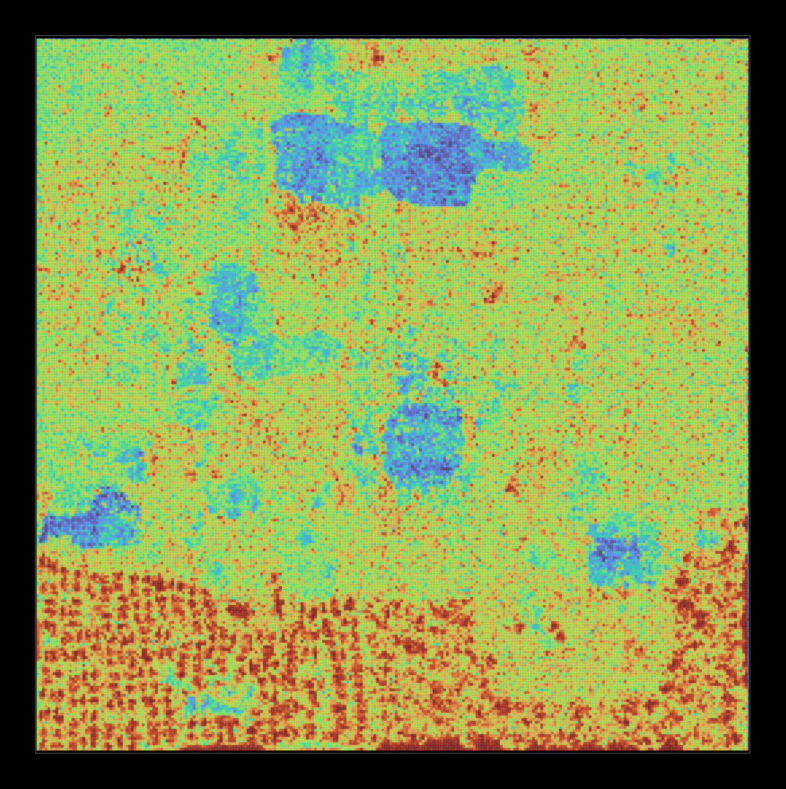
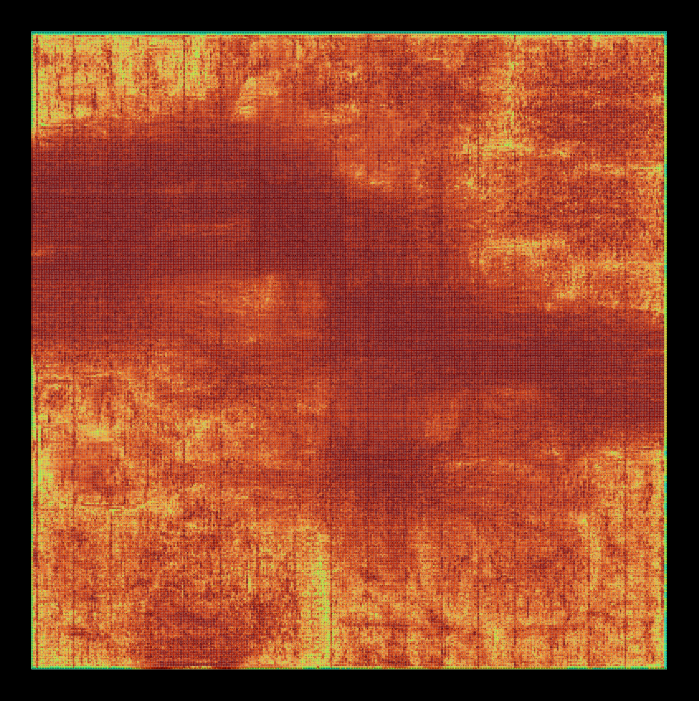
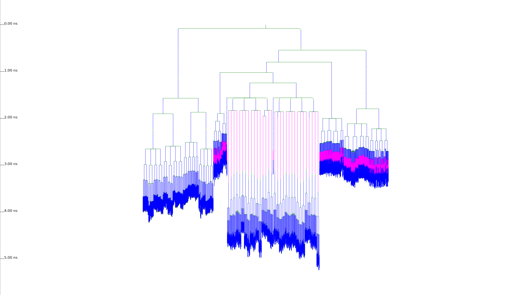
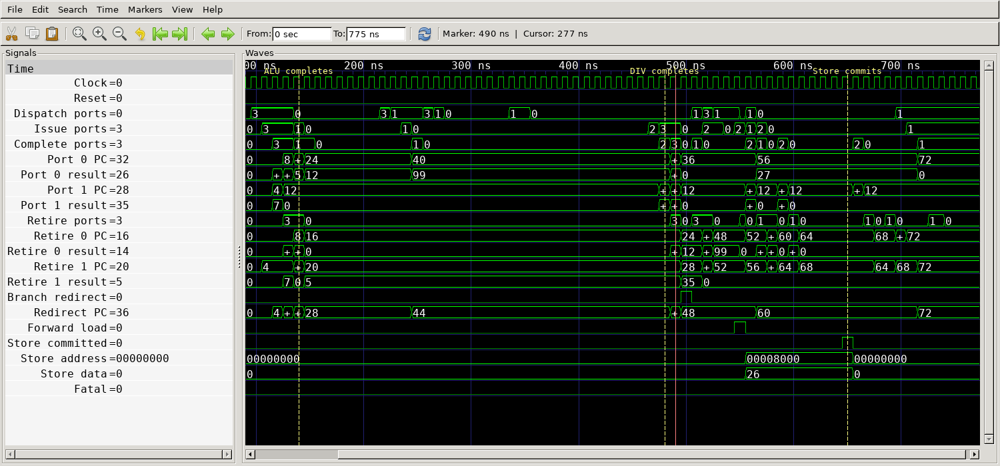

# Physical Design

H Core (`chip_top`, two-wide out-of-order RV32IM) taken from RTL to GDSII on
SkyWater Sky130 (`sky130_fd_sc_hd`) with LibreLane 3.0.16, the successor to
OpenLane 2. The design is fully routed: 0 routing DRC errors and a GDS
written. It does not meet its 15 ns target. Typical-corner timing closes at
24.07 ns (41.5 MHz). The slow corner needs 48.44 ns, and hold fails in every
corner.

## Key results

| Metric | Value |
|---|---|
| Target clock | 15 ns (66.7 MHz) |
| Achieved, typical (`nom_tt_025C_1v80`) | 24.07 ns, 41.5 MHz (setup WNS −9.07 ns) |
| Achieved, slow (`max_ss_100C_1v60`) | 48.44 ns, 20.6 MHz |
| Achieved, fast (`min_ff_n40C_1v95`) | meets 15 ns (+0.64 ns) |
| Hold | fails in all 9 corners (typical worst −1.02 ns) |
| Die / core area | 2653.2 × 2663.9 µm (7.07 mm²) / 6.98 mm² |
| Utilization | 54.6 % |
| Standard cells (excluding fill and tap) | 414,631 |
| Flip-flops / clock gates / macros | 49,442 / 1,088 / 0 |
| Routed wire length | 21.29 m |
| Power (vectorless) | 0.182 W typical, 0.220 W worst corner |
| Routing DRC (detailed router) | 0 |
| Antenna violations | 800 nets, 1,110 pins |
| IR drop, typical | 1.38 mV VPWR, 1.19 mV VGND (0.08 %) |
| Magic DRC, KLayout DRC, LVS, XOR | running, started 2026-11-15 |
| Gate-level CoreMark | running, started 2026-11-15 |

## Layout gallery

| | |
|---|---|
|  |  |
| KLayout: full die, sky130A layer colors, marker layers hidden. | KLayout: 60 × 40 µm window at (570–630, 1680–1720) µm. |
|  |  |
| OpenROAD: routed database. | OpenROAD: the 61 nets of the worst setup path highlighted. |
|  |  |
| OpenROAD heat map: placement density. | OpenROAD heat map: routing congestion. |



OpenROAD clock-tree viewer: insertion delay from `clk_i` to every sink, with
routed parasitics.

## Architecture

See the [architecture guide](../architecture/README.md) for the RTL diagram
and design choices. On chip, the L1 caches and the 64-entry register file are
flip-flop arrays (no SRAM macros). The cache arrays are clocked through
`sky130_fd_sc_hd__dlclkp_1` clock gates.

## Verification

| Check | Result |
|---|---|
| CoreMark, RTL (2 iterations, RV32IM, memory latency 1) | 633,494 cycles, 647,465 instructions retired, exit 0 |
| CoreMark, RTL `chip_top` on the gate-level bench | last memory request at cycle 633,492 |
| CoreMark, routed gate-level netlist | running |

The gate-level run compares the routed netlist with the RTL, cycle by cycle,
at the memory ports. Command: `verif/gls/run_gls.sh rtl|gates OUT`. It is
zero-delay and two-state (`--x-initial 0`). It does not check timing or
X-propagation. See the [verification guide](../verification/README.md) for
the RTL suites.



## Timing closure

The target was 15 ns. Before routing, the post-CTS period scan qualified
17 ns (setup +1.90 ns, hold +0.09 ns). After routing, typical timing needs
24.07 ns.

**Worst setup path** (typical corner, slack −9.07 ns):
`lsu.cached.entry_done_q[0]` → `core.backend.wait_data_q[0][3]`.

| Block on the path | Cells | Arrival at block exit (ns) |
|---|---|---|
| Launch clock latency | — | 3.68 |
| Load/store unit (`early_loads.lsu`) | 4 | 5.75 |
| Backend (`core.backend`) | 2 | 8.97 |
| Issue queue (`backend.queue`) | 14 | 17.29 |
| Register file (`backend.registers`) | 8 | 26.60 |
| Operand capture (`core.backend`) | 7 | 27.63 |
| Repair buffers at top level, between the blocks above | 26 | — |

The path has 61 cells: 32 logic gates and 29 buffers or inverters. Cell
delay is 23.30 ns and wire RC delay is 0.65 ns, so logic depth dominates,
not one long route. The largest fan-out on the path is 22.

**Hold.** The worst hold paths start at input ports. One is `rst_i` into the
reset synchronizer (−1.02 ns): data arrives at 2.99 ns, but the capture clock
reaches the flop at 3.98 ns. The other is `response_i` into I-cache registers
(−0.96 ns). The worst register-to-register hold path is inside the I-cache
(−0.71 ns). Clock skew is 2.27 ns (typical, setup). The latest source
register is in the I-cache, at 3.90 ns. The earliest target is a cache
clock gate, at 1.83 ns.

<details>
<summary>Worst setup path, summary lines (typical corner)</summary>

```
Startpoint: core.backend.systems.memory_service.early_loads.lsu._26043_
Endpoint: core.backend._36247_ (rising edge-triggered flip-flop clocked by core)
                                             27.626822   data arrival time
                                             18.559578   data required time
                                             -9.067244   slack (VIOLATED)
```

Source: `route_fin/11-openroad-stapostpnr/nom_tt_025C_1v80/max.rpt`. Register
names come from the flops' `Q` nets in `route_fin/final/nl/chip_top.nl.v`.
</details>

**Fixes, tied to the evidence**

| Fix | Evidence | Cost |
|---|---|---|
| Add a register between issue select and the register-file read, or between LSU completion and wake-up | 32 logic gates across four blocks on one path | an extra cycle for dependent instructions; CPI rises |
| Turn on post-global-route design repair (`RUN_POST_GRT_DESIGN_REPAIR`, now false) | 17 ns before routing vs 24.07 ns after | runtime |
| Constrain inputs against clock latency and repair input hold | worst hold paths start at `rst_i` and `response_i` | buffers on input paths |
| Balance cache clock-gate latency against the register tree | 2.27 ns setup skew; latest source 3.90 ns vs gate target 1.83 ns | CTS tuning |
| Relax the clock to the measured period | 24.07 ns typical, 48.44 ns slow | frequency |

## Design trade-offs

| Decision | Bought | Cost |
|---|---|---|
| Flip-flop caches and register file, no SRAM macros | one standard-cell flow, no macro placement | 49,442 flops, a large clock tree, a 7.07 mm² die |
| Clock gates on cache arrays (1,088 gates) | storage flops load only when written | skew between gated and ungated clocks; hold failures in the I-cache |
| Core utilization 45 %, placement density 55 % | routes with 0 DRC errors | 54.6 % utilization; 21.29 m of wire |
| Delay-oriented synthesis (`SYNTH_STRATEGY DELAY 0`) | mapping that targets path delay | no area-strategy run to compare against |
| One detailed-routing thread (`DRT_THREADS 1`) | fits the 14 GB host | detailed routing took about 30 hours (two full routes) |
| Global routing allowed to overflow (`GRT_ALLOW_CONGESTION` true) | reached detailed routing | congestion left to the detailed router |

## Limitations and next steps

- Setup fails in 8 of 9 corners at 15 ns. Hold fails in all 9.
- 800 antenna nets remain.
- Max slew and max capacitance violations: 10,571 and 3,315 typical;
  104,679 and 8,876 in the worst corner.
- Sign-off DRC, LVS and XOR were not run before the GDS was written; they
  are running now.
- IR drop used OpenROAD's default supply points (no pad locations given) and
  vectorless power, so it is optimistic.
- Power is vectorless, not sign-off power.
- No timing-annotated (SDF) gate-level simulation.
- The flow was hand-chained with manual OpenROAD edits. Its scripts live in
  the local, untracked `out/` directory.

Next: the pipeline register on the wake-up path, post-route repair and
input hold constraints, then a re-route.

## Reproducing the run

| Item | Value |
|---|---|
| Flow | LibreLane 3.0.16, Docker image `ghcr.io/librelane/librelane@sha256:02d50f259d48…` |
| Tools | OpenROAD `dcf36133`, Yosys 0.62, Magic 8.3 (revision 623) |
| PDK | sky130A, `sky130_fd_sc_hd`, ciel version `8afc8346a57fe1ab7934ba5a6056ea8b43078e71` |

The run is a chain of LibreLane step ranges. Each tag resumes from the
previous tag's state:

| Tag | Steps |
|---|---|
| `current_place`, `current_cts` | synthesis through placement, CTS and post-CTS STA |
| `grt_probe` | `OpenROAD.GlobalRouting`, after a manual clock-root move and repair |
| `post_grt` | `OpenROAD.ResizerTimingPostGRT` |
| `route_drt` | `OpenROAD.DetailedRouting` → `OpenROAD.STAPostPNR` |
| `route_fin` | `Odb.RemoveRoutingObstructions` → `OpenROAD.STAPostPNR` |
| `gds` | `Magic.StreamOut` → `KLayout.StreamOut` |
| `so_*` | IR drop, XOR, KLayout DRC, LVS, Magic DRC |

A typical call:

```
python3 -m librelane --manual-pdk --pdk-root <ciel>/sky130/versions/8afc8346… \
  --pdk sky130A --scl sky130_fd_sc_hd --run-tag gds \
  --from Magic.StreamOut --to KLayout.StreamOut \
  --with-initial-state <route_fin STA state_out.json> config_fin.json
```

## Evidence index

Paths are relative to the local run directory `out/placement_2026-11-14/`,
which is not committed. `STA` = `physical/runs/route_fin/11-openroad-stapostpnr`;
`M` = `physical/runs/route_fin/final/metrics.json`.

| Metric | Source |
|---|---|
| Target clock | `physical/chip_top.sdc:1` |
| Pre-route period scan (15 ns: setup −0.10 ns) | `period_scan/progress.json` |
| Synthesis-level timing (10 ns target: −0.94 ns ideal, −4.82 ns 10× wire) | `out/best_model_rtl_2026-11-13/timing17.log` |
| Min period per corner | `STA/<corner>/clock.rpt` |
| Setup / hold slack, TNS, violator counts | `M` → `timing__setup__ws__corner:*`, `timing__hold__ws__corner:*` and related |
| Worst setup and hold paths | `STA/nom_tt_025C_1v80/max.rpt`, `min.rpt` |
| Clock skew | `STA/nom_tt_025C_1v80/skew.max.rpt`; `M` → `clock__skew__worst_setup__corner:*` |
| Die, core, utilization | `M` → `design__die__bbox`, `design__core__area`, `design__instance__utilization` |
| Cell counts | `M` → `design__instance__count__stdcell`, `…class:sequential_cell`, `…class:clock_gate_cell`, `design__instance__count__macros` |
| Wire length, routing DRC | `route/route.log` (total wire length; DRT-0199) |
| Antenna | `physical/runs/route_fin/02-openroad-checkantennas-1/reports/antenna_summary.rpt` |
| Power | `STA/<corner>/power.rpt` |
| Max slew / cap | `M` → `design__max_slew_violation__count__corner:*`, `design__max_cap_violation__count__corner:*` |
| IR drop | `physical/runs/so_irdrop/01-openroad-irdropreport/irdrop.rpt` |
| Config knobs | `physical/runs/route_fin/resolved.json` |
| Tool versions | `receipt.json` → `tool_versions`; Magic from `physical/runs/gds/01-magic-streamout` log |
| Detailed-routing time | `route/progress.txt` |
| CoreMark, RTL | `out/best_model_rtl_2026-11-13/step17.log:1–2` |
| CoreMark, gate-level bench | `out/gls_2026-11-15/{rtl,gates}/sim.log` |
