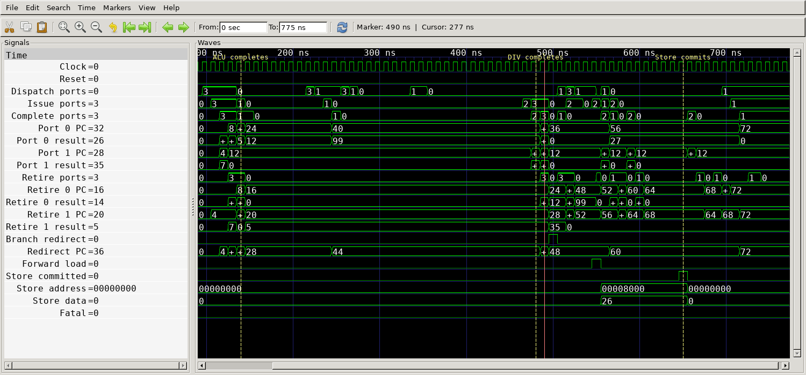

# Verification

The core is checked at four levels, each aimed at a different kind of bug. The
tests are themselves tested: deliberate RTL faults must make them fail.

## Strategy and results

| Level | Method | Catches | Result |
|---|---|---|---|
| Unit | Verilator benches against C++ reference models; directed, random, stall and reset cases | handshake and state bugs inside one block | 24 of 28 benches pass on 3 seeds each and detect all 469 injected RTL faults |
| Core | CoreMark in lockstep with a reference model | wrong results in a real program | 647,465 retired instructions match the reference trace |
| Core | Sail differential: the official RISC-V model runs the same seeded programs, including stall and reset modes | misreadings of the ISA spec that a home-made model would share | pass; all 20 injected RTL faults and 9 corrupted traces detected (cached RV32IM build) |
| Core | ACT4 architectural tests (RV32I, Zicsr, Zifencei) | instruction-level spec compliance | 39 tests × 2 modes × 3 seeds (234 runs) on each of 6 core configurations pass |
| Formal | SymbiYosys proofs | corners random tests rarely reach | store-forwarding selection; rename ownership by induction; equivalence of combinational timing rewrites (e.g. issue queue, 97 registers) |
| Gate | Routed netlist against RTL on CoreMark (`verif/gls/`) | synthesis or layout changing behavior | bench ready; RTL side ends at cycle 633,492; netlist run not completed |
| Static | Verilator `--Wall` lint; Python host tests | structural errors; broken checkers | 34 lint configurations clean; 171 host tests pass, 5 skipped |

## Why this mix

- **Reference models are fast but share my reading of the spec.** Sail and
  ACT4 are written by others, so they catch spec mistakes the C++ models
  would repeat.
- **A test that cannot fail proves nothing.** Mutation testing injects faults
  (for example, reversing issue-queue age order) and requires a failing run.
  One fault had only been caught by chance; it now has its own directed case.
- **Formal covers what randomness misses.** Store forwarding and rename
  recovery have rare multi-event corners; proofs cover them exhaustively
  within their bounds. Combinational timing rewrites, such as the
  issue-queue compare and the TAGE update, were proven equivalent before
  they replaced working RTL.
- **The same benches measure performance.** CoreMark runs count stalls and
  mispredicts while they check results. The numbers on the
  [architecture page](../architecture/README.md) come from these runs.

## Evidence

| Evidence | Screenshot | Scope |
| --- | --- | --- |
| Whole-core execution | [GTKWave](images/core-waveform.png) | 17 directed events match the software model; cached RV32M trace/physical lockstep. |
| RV32M RTL | [Simulation](images/muldiv-results.png) | Fresh baseline seeds; full mutation and synthesis gate not rerun for the capture. |
| Store forwarding | [Formal results](images/formal-results.png) | Combinational selector checks; excludes temporal queue/memory behavior. |
| Rename ownership | [Formal results](images/formal-results.png) | Inductive safety with at most four in-flight instructions and registers x0–x3. |

The waveform uses `chip_top`'s core configuration without its reset wrapper.
Younger ALU work completes before the divide, then retires after it. Branch
recovery skips a wrong-path store; forwarding supplies the load with 26. PCs
and results are decimal, store addresses hexadecimal. Values apply when their
accept bits assert. The time axis is simulated, not measured timing.

## Gaps

| Gap | Detail |
|---|---|
| Four unit benches not rerun after the last contract update | `csr_unit`, `cpu_top`, `frontend_faults`, `execution_backend` |
| Sail and ACT4 last ran on the RTL one step before the routed version | not rerun on the final step |
| Formal proofs not rerun on the final RTL | results are from the RTL each proof was written for |
| RV32M is not in the ACT4 subset | covered by Sail, the RV32M unit bench and CoreMark |
| No gate-level result, no timing-annotated simulation | the netlist compile was stopped before it finished |

## Reproduce

| Scope | Command |
| --- | --- |
| Fast checks | `make check-fast` |
| Full RTL, formal, and architectural gates | `make check-all` |
| Full RV32M unit gate | `make muldiv-unit-check` |
| Forwarding proofs | `make store-forward-check` |
| Rename ownership | `make rename-recovery-ownership-check` |
| Gate-level CoreMark (RTL, then netlist) | `verif/gls/run_gls.sh rtl OUT`, `verif/gls/run_gls.sh gates OUT` |
| Host tests | `python3 -m unittest discover -s tests -p 'test_*.py'` |

Use the [toolchain](../../config/toolchain.lock) and
[synthesis](../../config/synthesis.lock) pins.

[Architecture](../architecture/README.md) · [Physical design](../physical/README.md)
